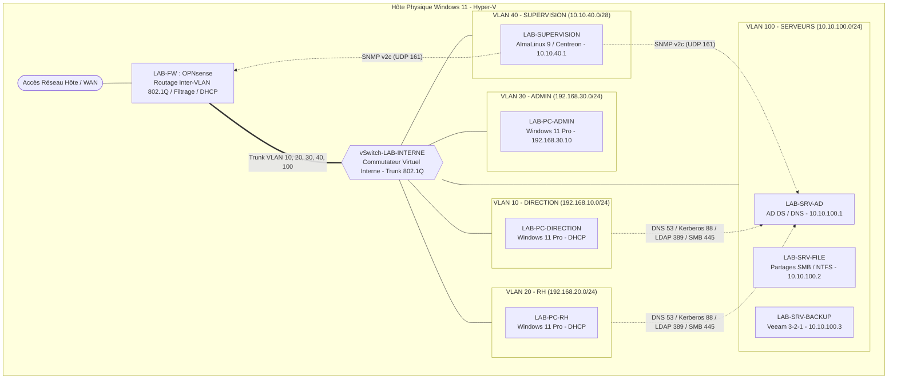

# 🏢 Homelab Infrastructure d'Entreprise — Hyper-V, OPNsense, AD & Centreon

> **Projet Portfolio — Administrateur d'Infrastructures Sécurisées (RNCP)**  
> Maquette virtualisée sous **Windows 11 + Hyper-V (Type 1)** reproduisant l'infrastructure système et réseau segmentée d'une PME : routage inter-VLAN 802.1Q, filtrage pare-feu centralisé, annuaire Active Directory, serveur de fichiers, stratégie de sauvegarde 3-2-1 et supervision centralisée.

---

## 🎯 Objectifs du projet

Genèse du projet — Ce homelab s'inscrit dans le prolongement direct du projet fil rouge réalisé durant ma formation chez Liora. Ce dernier portait sur l'audit complet et la conception d'une nouvelle infrastructure pour une entreprise spécialisée dans l'analyse des fonds marins, engagée dans une phase de forte croissance à la suite d'une levée de fonds.

L'exercice initial s'arrêtant à la phase d'audit, d'architecture cible et de restitution documentaire (sans déploiement technique), j'ai créé ce homelab pour pousser la démarche jusqu'à l'implémentation concrète. Afin de respecter les capacités matérielles de ma machine hôte tout en restant fidèle aux exigences du projet, j'en ai reproduit les principes clés à échelle réduite.

Cet environnement permet ainsi de déployer, sécuriser, superviser et documenter en conditions quasi réelles les briques fondamentales d'un système d'information d'entreprise :

- **Segmentation réseau & Sécurité (Couches 2/3)** : isolation par VLANs 802.1Q via un commutateur virtuel dédié (`vSwitch-LAB-INTERNE`) et filtrage inter-VLAN centralisé par **OPNsense** (`LAB-FW`).
- **Services d'Infrastructure & Isolation système (Couche 7)** : annuaire **Active Directory (AD DS)**, résolution **DNS**, découpage par Unités d'Organisation (Direction, RH) et permissions NTFS/SMB.
- **Supervision & Métrologie** : collecte **SNMP v2c** centralisée avec **Centreon** sous **AlmaLinux 9** et tableau de bord de synthèse (*Globale View Infrastructure LAB*).
- **Résilience & Sauvegarde** : stratégie **3-2-1** combinant sauvegarde locale (**Veeam Backup & Replication**) et externalisation cloud ciblée (**AWS Glacier**).

---

## 🗺️ Architecture Réseau

---

## 🌐 Plan d'Adressage IP (VLANs)

| ID VLAN | Nom du VLAN | Service / Destination | Sous-réseau | IP Statiques | Plage DHCP | Passerelle (OPNsense) | Broadcast |
| :---: | :--- | :--- | :--- | :--- | :--- | :--- | :--- |
| **10** | `VLAN-DIRECTION` | Postes Direction | `192.168.10.0/24` | — | `192.168.10.50` – `192.168.10.200` | `192.168.10.254` | `192.168.10.255` |
| **20** | `VLAN-RH` | Postes Ressources Humaines | `192.168.20.0/24` | — | `192.168.20.50` – `192.168.20.200` | `192.168.20.254` | `192.168.20.255` |
| **30** | `VLAN-ADMIN` | Poste Administrateur | `192.168.30.0/24` | `192.168.30.10` (`LAB-PC-ADMIN`) | — | `192.168.30.254` | `192.168.30.255` |
| **40** | `VLAN-SUPERVISION` | Serveur de Supervision | `10.10.40.0/28` | `10.10.40.1` (`LAB-SUPERVISION`) | — | `10.10.40.14` | `10.10.40.15` |
| **100** | `VLAN-SRV` | Serveurs d'Infrastructure | `10.10.100.0/24` | `10.10.100.1` (`LAB-SRV-AD`) `10.10.100.2` (`LAB-SRV-FILE`) `10.10.100.3` (`LAB-SRV-BACKUP`) | — | `10.10.100.254` | `10.10.100.255` |

> 📄 Détails complets et matrice de filtrage OPNsense disponibles dans [docs/plan-adressage.md](docs/plan-adressage.md).

---

## 💻 Inventaire & Dimensionnement des VMs

| Nom Hyper-V | OS | Rôle principal | VLAN | RAM | Type RAM |
| :--- | :--- | :--- | :---: | :--- | :--- |
| `LAB-FW` | OPNsense | Pare-feu, Routage inter-VLAN 802.1Q, DHCP | Trunk | 1024 – 2048 Mo | Fixe |
| `LAB-SRV-AD` | Windows Server 2025 | Contrôleur de Domaine (AD DS, DNS) | 100 | 2048 – 4096 Mo | Dynamique |
| `LAB-SRV-FILE` | Windows Server 2025 | Serveur de fichiers, partages SMB/NTFS | 100 | 2048 – 4096 Mo | Dynamique |
| `LAB-SRV-BACKUP` | Windows / Linux | Solution de sauvegarde (Veeam 3-2-1) | 100 | 2048 – 4096 Mo | Dynamique |
| `LAB-SUPERVISION` | AlmaLinux 9 | Serveur de métrologie & alerting (Centreon) | 40 | 2048 – 4096 Mo | Fixe |
| `LAB-PC-DIRECTION` | Windows 11 Pro | Poste client — Service Direction | 10 | 2048 – 4096 Mo | Dynamique |
| `LAB-PC-RH` | Windows 11 Pro | Poste client — Service RH | 20 | 2048 – 4096 Mo | Dynamique |
| `LAB-PC-ADMIN` | Windows 11 Pro | Poste d'administration dédié | 30 | 2048 – 4096 Mo | Dynamique |

---

## ✅ État d'avancement & Feuille de route

### Socle Réseau & Hyperviseur
- [x] Activation d'Hyper-V (Windows 11) et création du commutateur virtuel `vSwitch-LAB-INTERNE`
- [x] Déploiement d'**OPNsense** (`LAB-FW`) : sous-interfaces 802.1Q sur les 5 VLANs, passerelles et DHCP clients
- [x] Ouverture sélective des flux inter-VLAN vers l'AD (`UDP 53`, `Kerberos 88`, `LDAP 389`, `SMB 445`) et SNMP (`UDP 161`)
- [ ] Export et versionnement de la configuration XML OPNsense (sanitisée)

### Services d'Infrastructure & Domaine
- [x] Déploiement de `LAB-SRV-AD` (`10.10.100.1`) avec rôles **AD DS** et **DNS**
- [x] Conception de la structure d'Unités d'Organisation (OU `RH`, `Direction`)
- [ ] Application des **GPO** métier et durcissement des postes clients (`DIRECTION`, `RH`, `ADMIN`)

### Fichiers & Sauvegarde (Stratégie 3-2-1)
- [x] Validation du modèle de droits (partages `RH`, `Direction`, `Commun` + permissions NTFS par groupes AD)
- [x] Validation de la stratégie de sauvegarde **3-2-1** (local/NAS + cible cloud AWS Glacier)
- [ ] Déploiement complet de `LAB-SRV-FILE` (volumes dédiés, partages SMB/NTFS)
- [ ] Déploiement et tests de restauration sur `LAB-SRV-BACKUP` (**Veeam Backup & Replication**)

### Supervision & MCO (Centreon)
- [x] Déploiement de `LAB-SUPERVISION` (`10.10.40.1`) sous AlmaLinux 9 et sécurisation de la collecte **SNMP v2c**
- [x] Sondes actives : disponibilité hôtes (`FW`, `AD-SRV`, `Centreon-SRV`), CPU/RAM/Disque `C:` de l'AD, trafic des 5 VLANs OPNsense
- [x] Création du tableau de bord *« Globale View Infrastructure LAB »* et validation par injection de trafic inter-VLAN (RRDtool)
- [ ] Mise en place de l'**alerting** (relais SMTP/Postfix, contacts, politique de notification, option webhook Discord/Slack/Teams)
- [ ] Ajout de la **supervision applicative AD** (services `NTDS`/`DNS`/`Netlogon`, sonde `check_dns`, ports TCP `389`/`88`)
- [ ] Automatisation de la **sauvegarde Centreon** (cron MariaDB `centreon` + `centreon_storage` et `/etc/centreon*`)
- [ ] Ajustement du seuil *Warning* RAM de `LAB-SRV-AD` pour supprimer l'alerte orange permanente

---

## 📚 Documentation détaillée

- [Architecture & Dimensionnement Hyper-V](docs/architecture.md)
- [Plan d'Adressage & Matrice de Flux](docs/plan-adressage.md)
- [Supervision Centreon & MCO](docs/supervision.md)
- [Serveur de Fichiers & Stratégie de Sauvegarde 3-2-1](docs/sauvegarde.md)
- [Feuille de route & Livrables RNCP](docs/roadmap.md)
